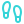
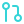

<!-- readme-standard: 2026-11-02 -->
<div align="center">



# TMadeAlex: brand-assets

*The TRADERMADE wordmark, its colours and its type, described from TMade Alex's own art, and how to use them.*


 **You are here:** TMadeAlex › `brand-assets` · public · `main` is the working branch

</div>

> **A gift, and a draft.** A member of TMade Alex's community set this shelf up for Alex as a gift. Alex decides what stays. Not legal advice: no lawyer has reviewed it, and it says nothing on his
> behalf.

##  TL;DR

1.  **What this is.** A brand shelf for TRADERMADE, TMade Alex's community: [`BRAND-GUIDELINES.md`](BRAND-GUIDELINES.md) describes his wordmark, his colours with their hexes, his type and his dark ground, drafted from the art he already uses.
2.  **Who it is for.** TMade Alex, and anyone making something for TRADERMADE with his yes.
3.  **Do this first.** Read [`BRAND-GUIDELINES.md`](BRAND-GUIDELINES.md). For the art itself, go to his own pages: [YouTube @TMadeAlex](https://www.youtube.com/@TMadeAlex) and [TRADERMADE on Whop](https://whop.com/tradermade).

##  What's here

```
brand-assets/
├── README.md              ← you are here
├── BRAND-GUIDELINES.md    ← the wordmark, the colours, the type, the dark ground; how to use them and not
├── TRADEMARKS.md          ← TRADERMADE, TMade and TMade Alex are his
├── LICENSE                ← what the licences cover, and what stays his alone
├── PROVENANCE.md          ← every picture here, every piece of his that was looked at, and why his art waits
├── PUBLIC-LANE-MEDIA.txt  ← the folders a person approved for pictures: none yet
├── logo/                  ← empty on main
├── photos/                ← empty on main
├── art/                   ← empty on main
├── banner/                ← one banner drawn in his colours, not his logo
└── assets/                ← this page's own banner and icons
```

##  His colours, at a glance

| | Hex | Where it is in his art |
|---|---|---|
|  | `#34d4d8` | the dot after "tradermade" |
|  | `#0c1719` | the ground |
|  | `#249094` | the small lettering and the thin ring |
|  | `#0e2224` | the glow behind the wordmark |

The rest, and how they are used, are in [`BRAND-GUIDELINES.md`](BRAND-GUIDELINES.md).

##  Why his art is not here yet

**On `main` there is no copy of his wordmark, his art or his photographs.** This shelf was set up before Alex had said
what he wants shown, and a copy of someone's logo in a place with their name on it should wait for their yes. A
branch with his three art files, `with-his-art`, exists only on Christopher's computer and goes up only if Alex says
yes. [`PROVENANCE.md`](PROVENANCE.md) lists each piece, where he publishes it, and when it was seen.

Anything of his that arrives here is his alone. It sits outside this repository's licences, and nobody may reuse it
without his word ([`LICENSE`](LICENSE)). A helper never decides what is shown in public: a person does, in
[`PUBLIC-LANE-MEDIA.txt`](PUBLIC-LANE-MEDIA.txt).

##  Not to be confused with

A market-data company is also called TraderMade. It is unrelated to TMade Alex and his community, and nothing here
links to it or draws from it. TRADERMADE, on these pages, always means his community on Whop.

##  Who keeps it

TMade Alex holds an owner's seat. Christopher W (@drasticstatic) is the second owner, with his helpers Alfred
(Claude Code) and Littlebird: a spare key, so the place never depends on one person.

##  Suggest a change

Noticed something? Open an [issue](../../issues) or a pull request against `main`. Christopher reads them, Alex decides what his brand says, and a person with the role merges with a merge commit. Not on GitHub? One message to Christopher is enough.

<sub>This front door follows the living [README standard](https://github.com/drasticstatic/my-template/blob/main/README-STANDARD.md). Copy it, improve it. What each licence covers is in [`LICENSE`](LICENSE). Icons: Lucide (ISC), see <code>assets/icons/LICENSE</code>.</sub>
